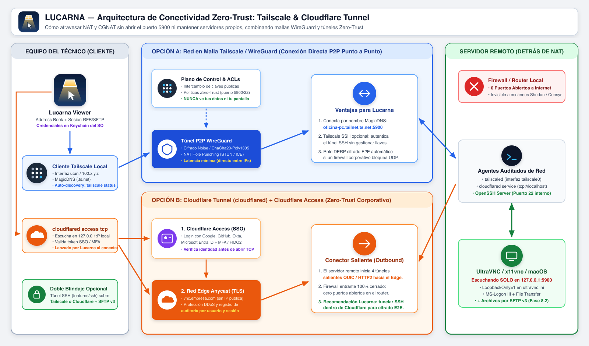
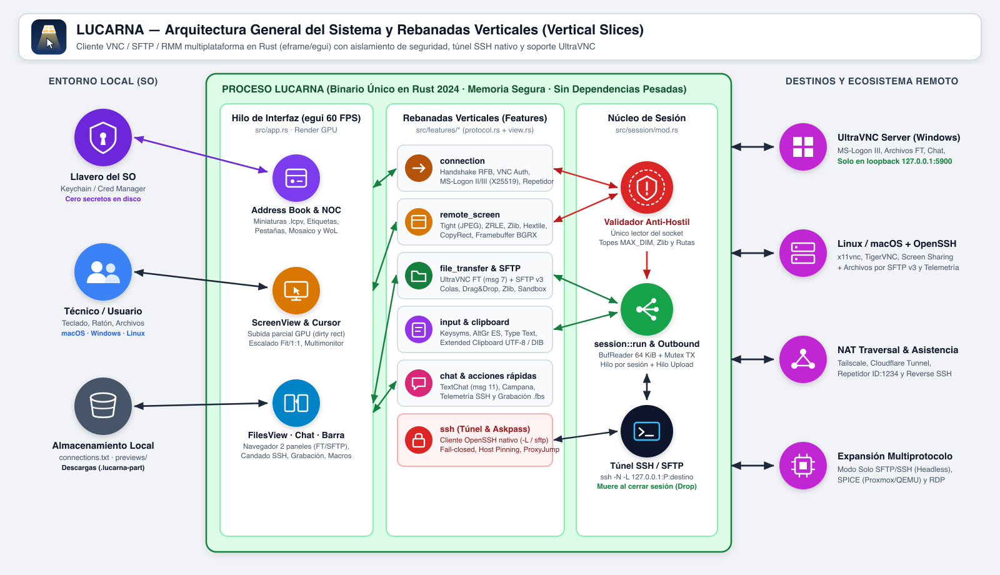
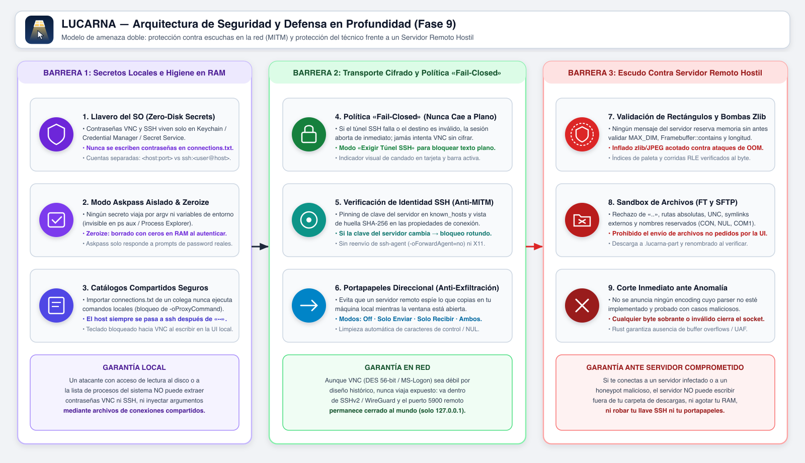

<p align="center">
  
</p>

<h1 align="center">Lucarna</h1>

<p align="center">Free, open-source VNC viewer for macOS, Windows and Linux, aiming at UltraVNC-compatible file transfer.</p>

Encodings: Tight (with JPEG for slow links), ZRLE, Zlib, Hextile, CopyRect, Raw. MS-Logon (Windows user and password) and VNC password login. RealVNC-style Address Book with remote desktop thumbnail previews, custom labels/groups, favorites, duplicate/rename, per-connection display & input options, and passwords kept in the OS keychain (never on disk). Local cursor (no lag). Session bar: view-only, fit or 1:1 scaling, full screen (⌘⇧F), special keys menu. Text chat with the remote user and UltraVNC repeater support (host:port or ID:1234). UltraVNC file transfer: two-pane local/remote browser with downloads, uploads, drag-and-drop queue, folder creation, rename and delete. Roadmap: [docs/ROADMAP.md](docs/ROADMAP.md).

The PNG is rendered from the SVG source; after editing `assets/logo.svg`, run:

```bash
rsvg-convert -w 512 -h 512 assets/logo.svg -o assets/logo.png
```

```bash
cargo run --release
```

## Install

Download the file for your system from the [latest release](https://github.com/BuilderJoy/lucarna/releases/latest), which also has step-by-step install instructions in Spanish. Lucarna is in early development (0.x): expect rough edges.

> **Important note for macOS (Apple Silicon & Intel):** Because Lucarna does not yet have Apple Developer notarization/code-signing approval, macOS Gatekeeper blocks installing the prebuilt `.dmg` directly. **On macOS, you must currently run or install Lucarna using Rust from source:**
> ```bash
> git clone https://github.com/BuilderJoy/lucarna.git
> cd lucarna
> cargo run --release
> ```
> *(Optional)* To generate and install `Lucarna.app` locally on your Mac with Rust:
> ```bash
> ./packaging/macos/bundle.sh 0.1.0 $(uname -m)
> cp -R target/release/bundle/Lucarna.app /Applications/
> ```
> *(If you still download the `.dmg` from Releases, macOS will reject it unless you remove the quarantine attribute in Terminal: `xattr -dr com.apple.quarantine /Applications/Lucarna.app` and allow it in **System Settings → Privacy & Security → Open Anyway**).*

- **Windows 10/11 (64-bit):** run `Lucarna-<version>-windows-x64-setup.exe`. The installer is not code-signed yet, so SmartScreen may warn: **More info → Run anyway**. It can install for your user only, without admin rights.
- **Linux (x86_64):** on Debian/Ubuntu, `sudo apt install ./lucarna_<version>_amd64.deb`. Elsewhere, extract `lucarna-<version>-linux-x86_64.tar.gz` and run `./lucarna`. Saving passwords needs a Secret Service keyring (GNOME Keyring or KWallet).

To build from source on any platform: `cargo run --release`.

## Using Lucarna over the internet: always through a tunnel

VNC does not encrypt the session. Screen, keystrokes (including passwords you type on the remote machine), clipboard and transferred files travel in clear text, and the logins are weak:

- **VNC password:** DES with at most 8 characters.
- **MS-Logon II:** a 31-bit key exchange that can be brute-forced in seconds, which exposes the **Windows** user and password.
- **MS-Logon III:** a strong key exchange, but the credentials are still encrypted with DES (56 bits). Details in [docs/ultravnc-auth.md](docs/ultravnc-auth.md).

**Never open port 5900 (or the repeater ports) to the internet.** Put one of these in front of it; Lucarna needs no extra settings, you just connect to the tunnel's local end.

**SSH tunnel** (the server, or a machine on its network, runs an SSH server; Windows 10+ ships OpenSSH Server as an optional feature):

```bash
ssh -N -L 5901:localhost:5900 user@server             # SSH runs on the VNC server itself
ssh -N -L 5901:192.168.1.20:5900 user@gateway         # or through another machine on its LAN
```

Then connect Lucarna to `localhost:5901`.

**VPN (Tailscale or WireGuard):** install it on both ends and connect to the server's VPN address or name (e.g. `office-pc.tailnet-name.ts.net`). Firewall port 5900 so it only accepts connections from the VPN.

**Cloudflare Tunnel with Access:** the server publishes `tcp://localhost:5900` through `cloudflared` under a hostname protected by an Access policy. On your Mac:

```bash
cloudflared access tcp --hostname vnc.example.com --url localhost:5901
```

Then connect Lucarna to `localhost:5901`.

**With an UltraVNC repeater**, tunnel to the repeater the same way: it only relays, so the traffic behind it is just as exposed.

UltraVNC's DSM encryption plugins (SecureVNC, MSRC4) are not supported, and VeNCrypt (TLS) is not implemented yet: a tunnel covers both cases with tools that are better audited.



## Architecture

Full walkthrough with diagrams (modules, threads, connection sequence, message dispatch, screen pipeline, file transfer, storage, extension guide): [docs/ARCHITECTURE.md](docs/ARCHITECTURE.md). Comprehensive threat model, attack vectors and security guarantees: [docs/SECURITY.md](docs/SECURITY.md).





Vertical slices, one per feature, named in the domain's language (RFB, RFC 6143):

```
src/
  main.rs            entry point
  app.rs             UI shell: connect form <-> live session
  session/           Session aggregate: owns the socket, routes server messages to features
  shared/wire.rs     big-endian wire primitives
  features/
    connection/      ServerAddress, handshake, VNC auth, saved connections, dashboard
    remote_screen/   Framebuffer, encodings, screen view
    input/           keysyms, key/pointer events
    clipboard/       cut text both ways
    chat/            UltraVNC text chat with the remote user
    file_transfer/   UltraVNC file transfer: two-pane browser, downloads, uploads, commands
```

Rules:
- A feature owns its domain types, its wire messages (`protocol.rs`) and its UI (`view.rs`).
- Features expose only what `mod.rs` re-exports. Cross-feature use goes through those exports.
- `session` is the only place that reads the socket; add a new server message by adding a match arm there that calls into your feature.
- Anything a malicious server sends is validated before use (sizes, rectangles, lengths).

## Tests

```bash
cargo test
docker build -t lucarna-test-server tests/server
docker run -d --rm --name lucarna-test -p 5999:5900 lucarna-test-server
VNC_TEST_ADDR=127.0.0.1:5999 VNC_TEST_PASSWORD=secret cargo test -- --ignored
```

## License

GPL-2.0-or-later
