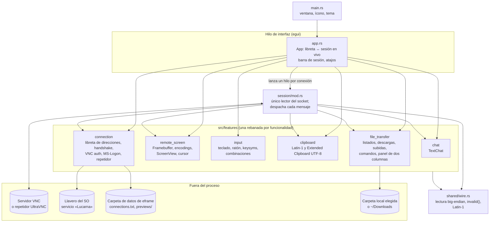
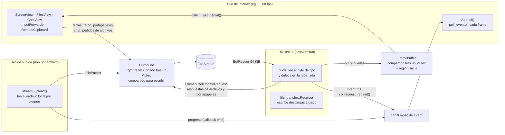
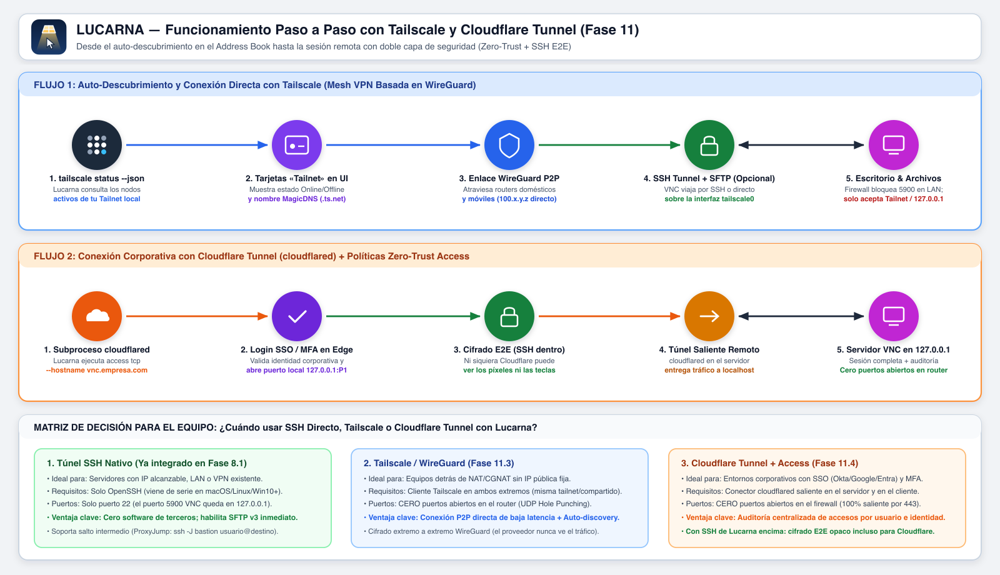
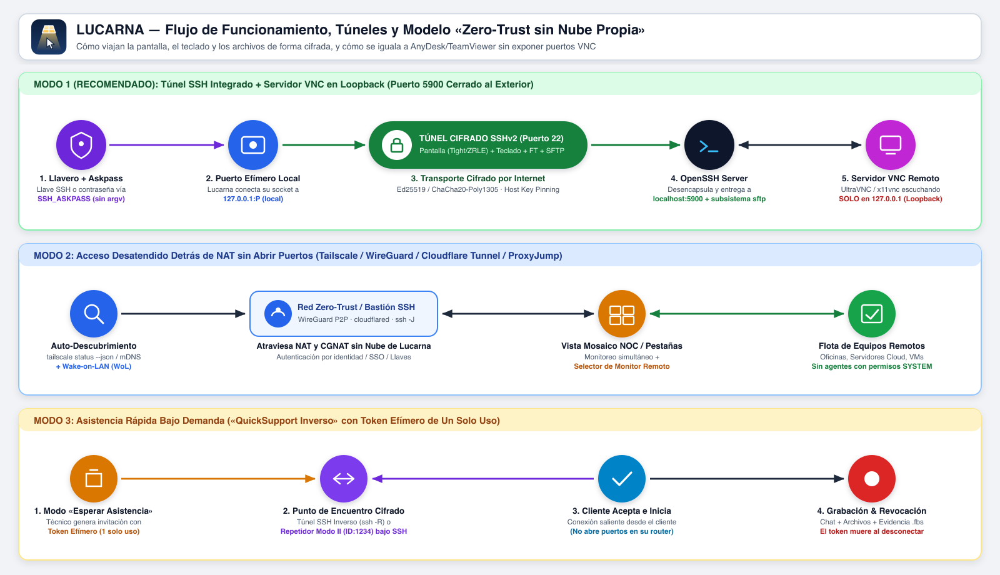
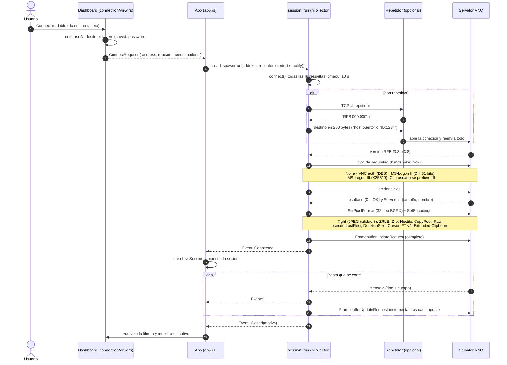
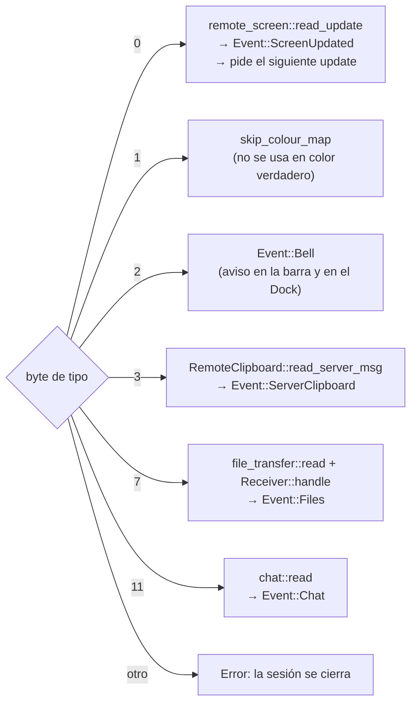
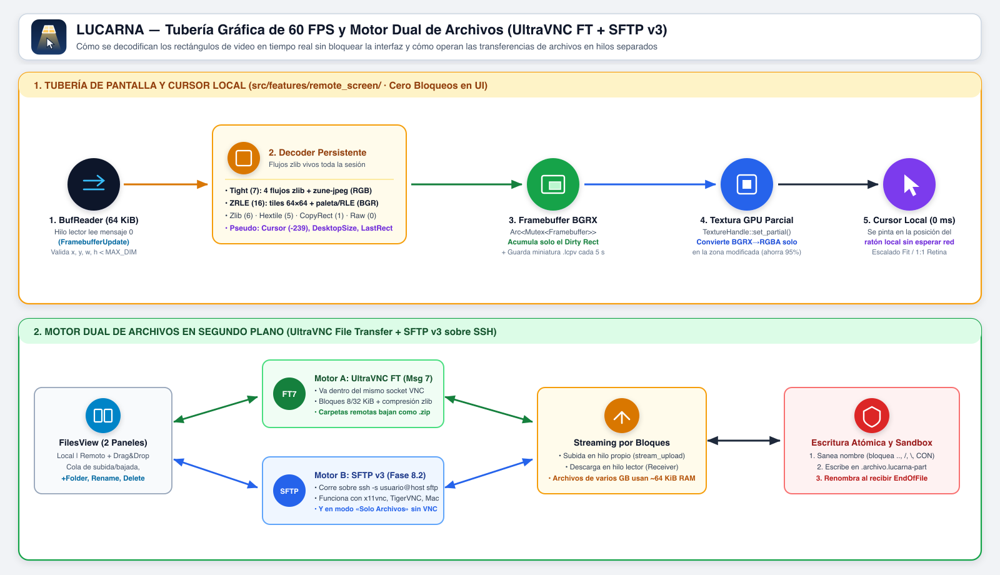
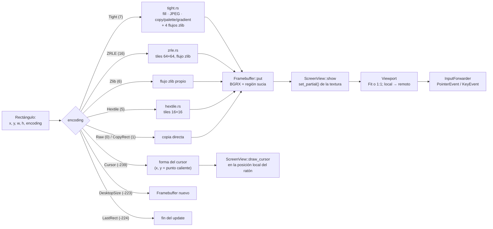
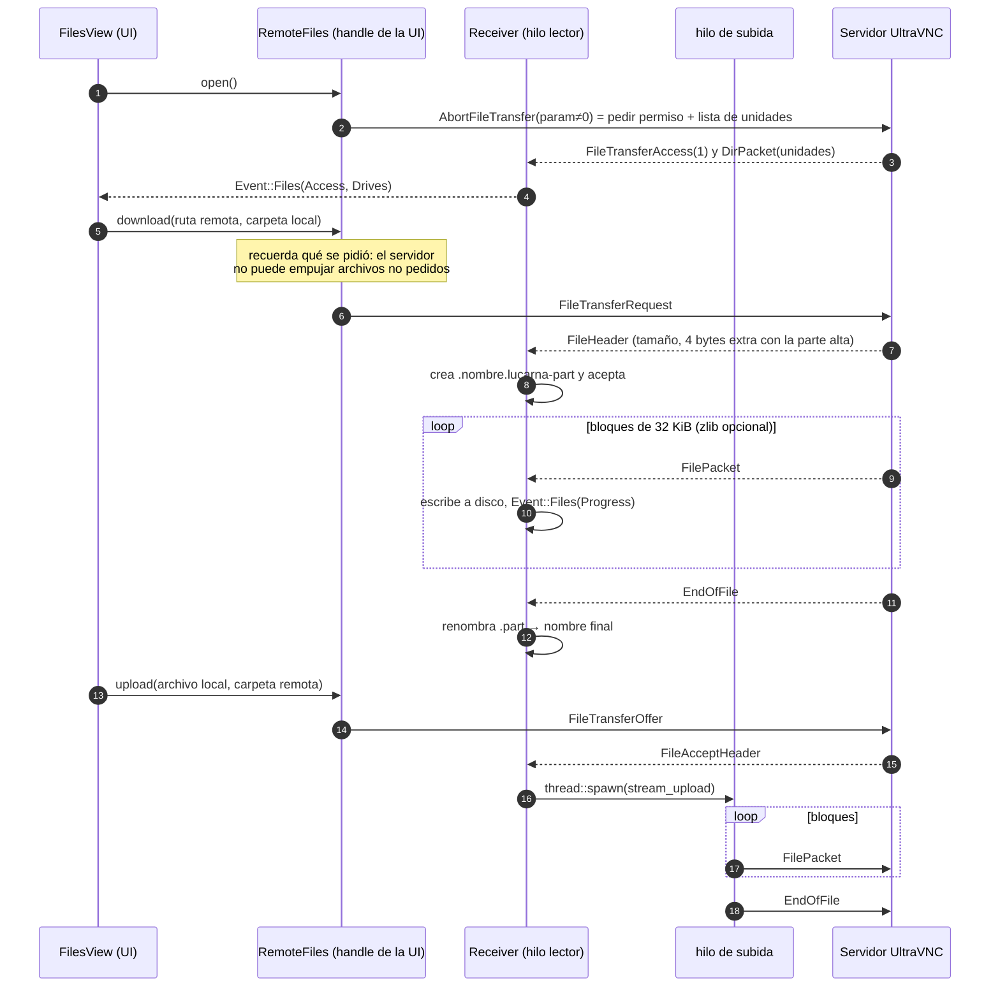

# Arquitectura de Lucarna

Lucarna es un visor VNC de escritorio en Rust (edición 2024) con [eframe/egui](https://github.com/emilk/egui) para la interfaz. Habla el protocolo RFB (RFC 6143) y las extensiones de UltraVNC: transferencia de archivos, MS-Logon, chat y repetidor. Este documento explica cómo está armado el código para que puedas ubicarte, cambiar algo sin romper otra cosa y añadir funciones nuevas.

Lecturas complementarias:

- [ROADMAP.md](ROADMAP.md): qué está hecho, qué falta y por qué se decidió cada cosa.
- [ultravnc-ft.md](ultravnc-ft.md): bytes exactos de la transferencia de archivos.
- [ultravnc-auth.md](ultravnc-auth.md): MS-Logon y sus límites de seguridad.
- [../CLAUDE.md](../CLAUDE.md): reglas de trabajo (ramas, tests, convenciones).

## 1. Mapa de módulos

El código está organizado en **rebanadas verticales por funcionalidad** (`src/features/*`), nombradas con el vocabulario de RFB. Cada rebanada es dueña de sus tipos, de sus mensajes de red (`protocol.rs`) y de su interfaz (`view.rs`). Solo lo que reexporta su `mod.rs` es público.




| Rebanada | Archivos | Responsabilidad |
|---|---|---|
| `connection` | `view.rs` (libreta), `saved.rs`, `handshake.rs`, `auth.rs`, `mslogon.rs`, `address.rs` | Pantalla de inicio, conexiones guardadas, versión RFB, tipo de seguridad, VNC auth, MS-Logon II/III, repetidor |
| `remote_screen` | `protocol.rs`, `framebuffer.rs`, `view.rs`, `tight.rs`, `zrle.rs`, `hextile.rs` | Formato de píxel, lista de encodings, `FramebufferUpdate`, imagen en memoria, textura y cursor local |
| `input` | `view.rs`, `protocol.rs`, `keysym.rs` | Traduce eventos de egui a `KeyEvent`/`PointerEvent`; Cmd→Ctrl en macOS; menú de teclas y AltGr |
| `clipboard` | `mod.rs` | Portapapeles en ambos sentidos; negocia UTF-8 (Extended Clipboard) y cae a Latin-1 |
| `file_transfer` | `protocol.rs`, `transfer.rs`, `view.rs` | Protocolo de archivos de UltraVNC (mensaje 7) y su panel |
| `chat` | `protocol.rs`, `view.rs` | Chat de texto de UltraVNC (mensaje 11) |
| `session` | `mod.rs` | Conecta, autentica, negocia y lee el socket en un bucle |
| `shared` | `wire.rs` | Primitivas de lectura compartidas |

## 2. Hilos, canales y estado compartido

Hay **un hilo de interfaz**, **un hilo lector por sesión** y, durante una subida, **un hilo por archivo subido**. Solo el hilo lector lee el socket; escribir pueden todos, a través de `Outbound`.



Puntos clave:

- **`Event`** (`session/mod.rs`) es todo lo que la sesión le cuenta a la interfaz: `Connected` (trae `Outbound`, `Framebuffer`, `RemoteFiles` y `RemoteClipboard`), `ScreenUpdated`, `Bell`, `Chat`, `Files`, `ServerClipboard` y `Closed`. Tras cada envío, la sesión llama a `notify()` (`ctx.request_repaint()`) para que egui pinte aunque el ratón no se mueva.
- **`Outbound::close()`** apaga el socket. El hilo lector sale del bucle con error y manda `Event::Closed`. Así se desconecta.
- **`Framebuffer`** guarda la imagen en BGRX y acumula una **región sucia**; `ScreenView` sube a la GPU solo ese rectángulo.
- **Las descargas se escriben en el hilo lector** y **las subidas leen el disco en su propio hilo**: el disco nunca bloquea la interfaz.

### Conectividad Zero-Trust: Tailscale y Cloudflare Tunnel

Además del túnel SSH directo, Lucarna se integra con redes en malla **Tailscale (WireGuard)** y túneles corporativos **Cloudflare Tunnel (`cloudflared access tcp`)**, manteniendo siempre el puerto `5900` cerrado a internet (escuchando solo en `127.0.0.1`).




## 3. Ciclo de vida de una conexión





## 4. Despacho de mensajes del servidor

`session::run` lee **un byte** con el tipo de mensaje y llama a la rebanada que lo entiende. **Un tipo desconocido corta la sesión**, porque RFB no manda la longitud de los mensajes y no hay forma de saltárselo. De ahí la regla: no se anuncia un encoding ni se activa una función del servidor hasta que su parser está listo y probado.



## 5. Tubería de la pantalla





- **El estado de descompresión dura toda la sesión.** ZRLE, Zlib y los cuatro flujos de Tight son flujos zlib que siguen de un update al siguiente; viven en `remote_screen::Decoder`, que se crea una sola vez en `session::run`.
- **Colores:** el TPIXEL de Tight llega como **R, G, B**; el CPIXEL de ZRLE son los 3 bytes bajos de nuestro píxel little-endian, o sea **B, G, R**. Confundirlos invierte rojo y azul.
- **Cursor local:** con el pseudo-encoding Cursor el servidor deja de dibujar el puntero en la imagen y manda su forma; Lucarna la dibuja donde está tu ratón, sin esperar a la red.

## 6. Transferencia de archivos



- `contentParam` viaja en **little-endian**; el resto del protocolo, en big-endian. Ver `ultravnc-ft.md`.
- Una carpeta se pide como `ruta\[ nombre ]`: el servidor la comprime y llega como `nombre.zip`, que se guarda sin descomprimir.
- Si la transferencia está desactivada en el servidor, **no responde nada**: el panel muestra el aviso tras 10 s.

## 7. Qué se guarda y dónde

| Dato | Dónde | Formato |
|---|---|---|
| Conexiones (nombre, dirección, usuario, etiquetas, opciones, última conexión, repetidor) | `eframe::storage_dir("Lucarna")/connections.txt` (en macOS, `~/Library/Application Support/Lucarna/`) | Una conexión por línea, columnas separadas por tabulador. Las columnas nuevas son opcionales, así que los archivos viejos siguen cargando |
| Contraseñas | Llavero del SO (Keychain, Credential Manager o Secret Service), servicio `Lucarna`, cuenta = dirección normalizada | **Nunca** se escriben a disco |
| Vistas previas del escritorio | `…/Lucarna/previews/*.lcpv` | Miniatura de 320×200 como máximo, cada 5 s mientras la sesión está abierta |
| Tamaño de la ventana | eframe (`persistence`) | Automático |

## 8. Reglas que no hay que romper (Defensa en Profundidad)


1. **El servidor es hostil hasta que se demuestre lo contrario.** Todo tamaño, longitud, rectángulo e índice se valida antes de reservar memoria o indexar: `MAX_DIM`, `Framebuffer::contains`, topes de zlib, longitudes de chat, archivos y portapapeles, nombres de archivo saneados.
2. **`session/mod.rs` es el único lector del socket.** Un mensaje nuevo del servidor se añade como un brazo del `match` que delega en su rebanada.
3. **No se anuncia lo que no se sabe leer.** Cada encoding nuevo se añade a la vez a la lista de `negotiate` y al `match` de `read_update`.
4. **Una rebanada no entra en las tripas de otra.** El uso entre rebanadas va por lo que exporta su `mod.rs`.
5. **El portapapeles va antes que las teclas.** `RemoteClipboard::forward_paste` corre antes que `InputForwarder::forward`, para que el texto llegue antes que el Ctrl+V.
6. **Lo que el usuario escribe en nuestra interfaz no llega al servidor.** La barra, los paneles de archivos y chat, y cualquier campo de texto con foco (`egui_wants_keyboard_input()`) cortan el reenvío de teclado y ratón.
7. **Dependencias mínimas.** Antes de añadir una crate, mira si ya se compila por eframe (`flate2`, `zune-jpeg`, `sha2`, `getrandom` llegaron así) o si std alcanza.

## 9. Cómo extender

**Añadir un encoding:**

1. Un archivo en `remote_screen/` (como `tight.rs`) que devuelva píxeles BGRX de `w*h*4` bytes.
2. Si usa estado entre updates, un campo en `Decoder`.
3. La constante y su lugar en la lista de `negotiate`, y el brazo en `read_update`.
4. Tests unitarios con datos hechos a mano o con fixtures en `tests/fixtures/`, y si el servidor de pruebas lo soporta, una prueba en vivo que compare contra Raw (ver `live_tight_matches_raw`).

**Añadir un mensaje del servidor:** el parser en su rebanada (`read(s) -> Msg`), un brazo en el bucle de `session::run`, una variante de `Event` y su manejo en `App::poll_events`.

**Añadir una rebanada:** `src/features/<nombre>/{mod.rs, protocol.rs, view.rs}`, regístrala en `features/mod.rs` y exporta solo lo necesario.

## 10. Tests

- **Unitarios:** viven junto al código, en `#[cfg(test)]`. `shared::wire::Duplex` simula una conexión (lee de un buffer y guarda lo escrito) para probar handshakes y protocolos sin red.
- **En vivo:** marcados con `#[ignore]`, contra x11vnc en Docker (`tests/server/`), que tiene transferencia de archivos de UltraVNC activada y pinta rampas de color para forzar los caminos de Tight:

```bash
docker build -t lucarna-test-server tests/server
docker run -d --rm --name lucarna-test -p 5999:5900 lucarna-test-server
VNC_TEST_ADDR=127.0.0.1:5999 VNC_TEST_PASSWORD=secret cargo test -- --ignored
```

  Incluyen `live_server` (sesión completa y archivos), `live_repeater` (a través de un repetidor mínimo) y `live_tight_matches_raw` (Tight idéntico a Raw).
- **Sin cubrir por un servidor real:** UltraVNC Server en Windows (MS-Logon, chat, carpetas en zip, Tight de UltraVNC) no se puede levantar en Docker; necesita una prueba manual.

## 11. Glosario

| Término | Significado |
|---|---|
| RFB | El protocolo de VNC (RFC 6143) |
| Framebuffer | La imagen del escritorio remoto en memoria |
| Encoding | Cómo viene comprimido cada rectángulo de pantalla |
| Pseudo-encoding | Valor que se anuncia como un encoding pero activa una función (cursor, cambio de tamaño, calidad JPEG, protocolo de archivos) |
| CPIXEL / TPIXEL | Píxel compacto de 3 bytes en ZRLE (B, G, R) y en Tight (R, G, B) |
| Keysym | Código de tecla X11, el vocabulario de teclado de RFB |
| MS-Logon | Login de UltraVNC con usuario y contraseña de Windows |
| Repetidor | Servidor intermedio de UltraVNC para llegar a máquinas detrás de NAT |
