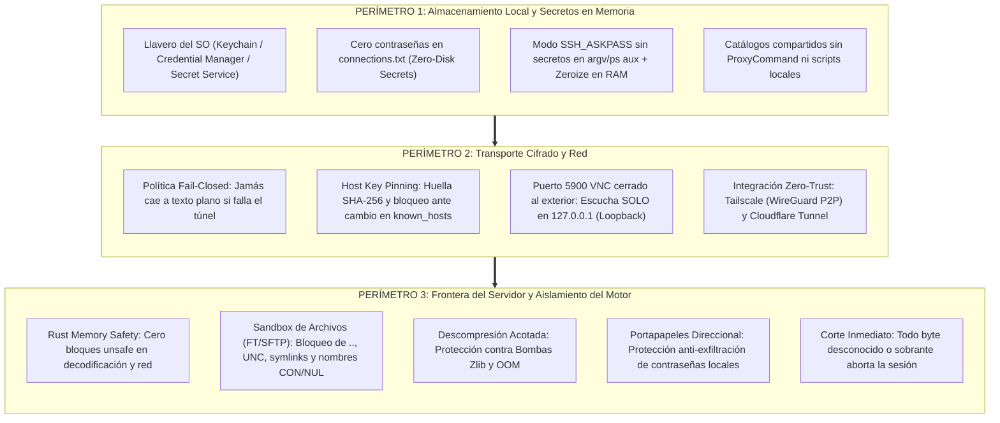

# Modelo de Amenazas y Garantías de Seguridad de Lucarna

Este documento detalla el **modelo de amenazas (*threat model*)**, la superficie de ataque, los vectores de explotación teóricos y las **garantías técnicas y arquitectónicas** que implementa Lucarna para asegurar que ningún atacante pueda vulnerar el equipo del técnico ni usar Lucarna con fines maliciosos.

---

## 1. Filosofía de Seguridad y Premisa Fundamental

> [!CAUTION]
> **Premisa Fundamental:**
> **Todo servidor remoto y todo archivo de catálogo importado se considera potencialmente hostil hasta que se demuestre lo contrario.**

A diferencia de visores VNC tradicionales (históricamente escritos en C/C++ como `libvncclient`, UltraVNC viewer o RealVNC clásico, que arrastran décadas de vulnerabilidades de corrupción de memoria), Lucarna fue concebida en **Rust 2024** bajo el principio de **Defensa en Profundidad en Tres Perímetros Concéntricos**:

---

## 2. Matriz de Vectores de Ataque y Cómo Garantizamos su Mitigación

A continuación se analizan los 6 vectores de ataque posibles, detallando la mecánica de explotación teórica y la **garantía técnica implementada** en el código:

| # | Vector de Ataque Teórico | Mecánica del Atacante | Garantía Técnica en Lucarna | Dónde se Aplica en el Código |
|---|---|---|---|---|
| **1** | **Bombas Zlib / OOM DoS en Video** | El servidor envía paquetes comprimidos Tight/ZRLE que expanden a gigabytes en RAM o declaran dimensiones gigantescas ($65535 \times 65535$) para provocar *Out-Of-Memory* o *Integer Overflow*. | **Descompresión acotada y validación previa:** Tope estricto de memoria (`MAX_DIM`), verificación de `Framebuffer::contains` antes de indexar, descompresión con buffer de salida acotado. Rust aborta limpiamente si se excede el límite y no permite *buffer overflows*. | [`src/features/remote_screen/tight.rs`](file:///Users/davidm/Workspace/lucarna/src/features/remote_screen/tight.rs) [`src/features/remote_screen/zrle.rs`](file:///Users/davidm/Workspace/lucarna/src/features/remote_screen/zrle.rs) [`src/features/remote_screen/framebuffer.rs`](file:///Users/davidm/Workspace/lucarna/src/features/remote_screen/framebuffer.rs) |
| **2** | **Path Traversal en Transferencia de Archivos (FT / SFTP)** | El servidor envía rutas como `../../.bashrc`, rutas absolutas (`/etc/shadow`) o Windows Startup para sobreescribir binarios del técnico al descargar o listar. | **Sanitización estricta y Sandbox:** Rechazo frontal de `..`, `/`, `\`, rutas UNC, symlinks externos y nombres reservados de Windows (`CON`, `PRN`, `AUX`, `NUL`, `COM1-9`). Descarga atómica siempre en `.lucarna-part` con verificación de ruta canónica. **Prohibido el Server Push** (solo se descargan archivos explícitamente pedidos por la UI). | [`src/features/file_transfer/protocol.rs`](file:///Users/davidm/Workspace/lucarna/src/features/file_transfer/protocol.rs) [`src/features/file_transfer/transfer.rs`](file:///Users/davidm/Workspace/lucarna/src/features/file_transfer/transfer.rs) |
| **3** | **Inyección de Argumentos en Subproceso SSH** | Se importa un catálogo manipulado con destinos tipo `-oProxyCommand=calc.exe` o `-oLocalCommand=...` para ejecutar comandos locales al lanzar el túnel SSH. | **Delimitador de escape forzoso `--`:** El host siempre se pasa a `ssh` después de `--`. Lista blanca estricta de caracteres en usuario y host (alfanuméricos, puntos, guiones). Opciones de `ssh` inyectadas son rechazadas antes de invocar `Command::new`. | [`src/features/ssh/mod.rs`](file:///Users/davidm/Workspace/lucarna/src/features/ssh/mod.rs) [`src/features/connection/address.rs`](file:///Users/davidm/Workspace/lucarna/src/features/connection/address.rs) |
| **4** | **Espionaje del Portapapeles (Clipboard Exfiltration)** | El servidor remoto solicita continuamente el contenido del portapapeles o escucha actualizaciones en segundo plano para robar contraseñas copiadas por el técnico en su gestor local. | **Portapapeles Direccional:** Modos `Off`, `Solo Enviar al Pegar`, `Solo Recibir` y `Bidireccional`. Por defecto se aísla la sincronización automática de fondo; el texto solo viaja cuando el técnico pulsa explícitamente Pegar en la ventana remota. Saneamiento automático de NUL y caracteres de control. | [`src/features/clipboard/mod.rs`](file:///Users/davidm/Workspace/lucarna/src/features/clipboard/mod.rs) |
| **5** | **Man-In-The-Middle (MITM) e Intercepción en Red** | Atacante en la misma red Wi-Fi o LAN intercepta tráfico VNC en claro o debilidades de claves DES (56 bits) / MS-Logon II para leer credenciales y pantalla. | **Fail-Closed + Host Key Pinning:** Toda conexión fuera de `127.0.0.1` exige túnel SSHv2 o VPN. Si el túnel falla, Lucarna aborta de inmediato (jamás cae a texto plano). Se valida la huella SHA-256 del host contra `known_hosts` y se bloquea ante cualquier discrepancia. | [`src/session/mod.rs`](file:///Users/davidm/Workspace/lucarna/src/session/mod.rs) [`src/features/ssh/mod.rs`](file:///Users/davidm/Workspace/lucarna/src/features/ssh/mod.rs) |
| **6** | **Uso Malicioso de la Herramienta (Living off the Land)** | Un atacante intenta usar Lucarna instalada en una máquina comprometida para abrir acceso remoto persistente y no autorizado (estilo malware con AnyDesk/TeamViewer). | **Ausencia de Servicio Residente Inbound:** Lucarna es exclusivamente un cliente/visor de escritorio. No instala servicios en segundo plano con privilegios `SYSTEM`/root ni abre puertos de escucha entrantes a internet. Todo túnel muere con el proceso (`Drop`). | [`src/features/ssh/mod.rs`](file:///Users/davidm/Workspace/lucarna/src/features/ssh/mod.rs) [`src/main.rs`](file:///Users/davidm/Workspace/lucarna/src/main.rs) |

---

## 3. Garantías de Seguridad en el Lenguaje y Compilador

### 1. Seguridad de Memoria Garantizada por Rust (Zero Unsafe en Red)
* **Cero buffers no verificados:** En C/C++, decodificar un tile de ZRLE o Hextile con índices erróneos causa corrupción de heap o ejecución arbitraria de código. En Lucarna, cada indexación está protegida por el compilador de Rust.
* **Prohibición de `unsafe` en capas de red:** Los módulos [`src/session/`](file:///Users/davidm/Workspace/lucarna/src/session/), [`src/features/remote_screen/`](file:///Users/davidm/Workspace/lucarna/src/features/remote_screen/) y [`src/features/file_transfer/`](file:///Users/davidm/Workspace/lucarna/src/features/file_transfer/) no contienen bloques `unsafe`. El código no tiene riesgo de vulnerabilidades tipo:
  * *Use-After-Free* (UAF)
  * *Double Free*
  * *Buffer Overflow / Out-of-Bounds Write*
  * *Data Races* en hilos concurrentes

### 2. Aislamiento de Secretos en Memoria (Zeroize & No-Disk Storage)
* **Llavero Nativo:** Las contraseñas nunca tocan el disco ni se guardan en texto plano en [`connections.txt`](file:///Users/davidm/Workspace/lucarna/src/features/connection/saved.rs). Viven en el Keychain de macOS, Credential Manager de Windows o Secret Service de Linux bajo el servicio `Lucarna`.
* **Protección de Argumentos (`ps aux`):** Al lanzar `ssh`, la contraseña jamás pasa por variables de entorno expuestas ni por argumentos de línea de comandos. Se canaliza por el protocolo `SSH_ASKPASS` interno.
* **Sobreescritura en RAM (*Zeroize*):** Las estructuras que almacenan credenciales en memoria temporal limpian sus buffers con ceros al salir del ámbito (`Drop`), impidiendo que persistan en volcados de memoria tras un fallo.

---

## 4. Política de Verificación Continua y Batería de Pruebas

Para asegurar matemáticamente que estas mitigaciones no se degraden con el tiempo:

1. **Fixtures Binarios Maliciosos:**
   En `tests/fixtures/` y módulos de pruebas unitarias (`#[cfg(test)]`) se prueban intencionalmente entradas diseñadas para romper clientes comunes:
   * Rectángulos con coordenadas negativas o que desbordan el framebuffer.
   * Tiles ZRLE con paletas truncadas o subencodings 17 a 127 inválidos.
   * Bloques de archivos con nombres como `../../../../etc/passwd` o `..\..\Windows\system32\cmd.exe`.
   * Servidores que envían datos sobrantes o se desconectan a mitad de paquete.
2. **Pruebas de Integración con Fallos Inducidos:**
   * `live_ssh_tunnel`: comprueba el túnel real y valida que si el servidor prohíbe el reenvío de puertos (`AllowTcpForwarding no`) o la clave del host no coincide, Lucarna corte la conexión de forma segura y controlada.
3. **Regla de Rechazo Inmediato:**
   * Si el bucle de [`src/session/mod.rs`](file:///Users/davidm/Workspace/lucarna/src/session/mod.rs) recibe un byte de tipo de mensaje que no está explícitamente soportado y validado, la sesión **se cierra de inmediato**. No se permite continuar en estados deserializados ambiguos.
