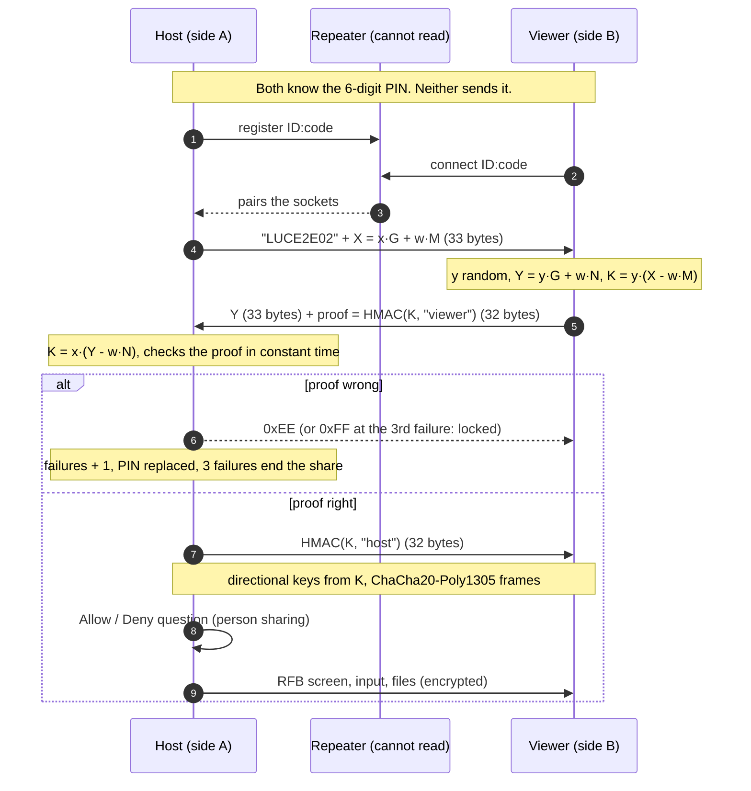

# End-to-end handshake (Lucarna E2EE, wire `LUCE2E02`)

The host and the person helping share a short PIN. The PIN is the *password* of a SPAKE2 exchange, so the
PIN never travels and a recording of the exchange cannot be used to try PINs at home. The repeater only
moves bytes it cannot read.

`w` is a hash of the PIN, `G` the group generator, `M` and `N` fixed public points. A wrong PIN gives a
different `K` that looks random, so the proof fails and nothing about the PIN leaks.

What stays true: a live attacker still gets one guess per connection (the host counts three), and the viewer
has no lock of its own. What is gone: guessing offline from a recording.
