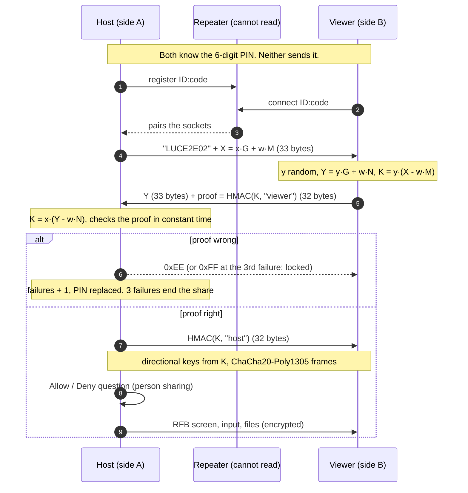

# End-to-end handshake (Lucarna E2EE, wire `LUCE2E02`)

The host and the person helping share a short PIN. The PIN is the *password* of a SPAKE2 exchange, so the
PIN never travels and a recording of the exchange cannot be used to try PINs at home. The repeater only
moves bytes it cannot read.

`w` is a hash of the PIN, `G` the group generator, `M` and `N` fixed public points. A wrong PIN gives a
different `K` that looks random, so the proof fails and nothing about the PIN leaks.

What stays true: a live attacker still gets one guess per connection (the host counts three), and the viewer
has no lock of its own. What is gone: guessing offline from a recording.

## For an external reviewer

What was checked by us, and what was not.

- **Crate:** `spake2` 0.4.0 (RustCrypto/PAKEs, Ed25519 group, about 1.7 M downloads). Its README says it has never had an independent audit. A 0.5.0 pre-release exists (January 2026) with no date for the stable one. No RustSec or GitHub advisory affects it. It follows the Python `spake2` of magic-wormhole, not RFC 9382, so it does not interoperate with other SPAKE2 implementations.
- **Where to look in the crate:** `bytes_to_element` only decompresses the peer point; there is no cofactor clearing and no rejection of small-order points. An attacker can send a small-order point, which can leak a few bits of the PIN hash per try. With three tries per PIN and a PIN that changes after that, we judge it not exploitable, but a reviewer should confirm.
- **Where to look in Lucarna:** `shared/crypto.rs` (`host_e2ee_handshake`, `viewer_e2ee_handshake`, `keys_from_shared`): identities are fixed strings (`lucarna-host`, `lucarna-viewer`), not bound to the session code; proofs are `HMAC(K, label)`; key derivation reuses `pbkdf2_sha256` with one iteration as an HMAC-based KDF; the 0xEE / 0xFF reply tells the viewer apart a wrong PIN from a lock.
- **Not done:** a third-party review, interoperability tests with another implementation, and a run against a real repeater.
